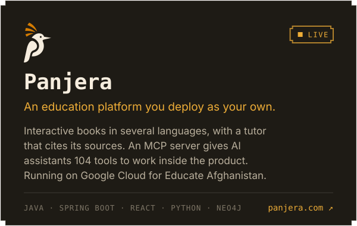
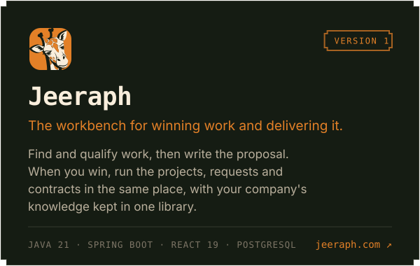

I'm Homayoon, a software engineer and founder in Falls Church, Virginia. I've spent twelve years writing and testing software, most of it for federal and financial systems, and I run [Dev Fusion Lab](https://www.devfusionlab.com), a small studio where I build my own products.

By day I'm the technical lead on a data platform that holds hundreds of millions of records. I designed its current data model and API contract, and I still write code there every day. The ten years of test automation before that left me with a habit I can't shake: I want proof that software does what it claims, so I build the checks alongside the product.

On my own time I build products of my own. [Panjera](https://panjera.com) is in production, and I'm building [Jeeraph](https://jeeraph.com) now. Agents help, and I use them, but I write my own code and read every line that ships. I came up as a developer and I still work like one.

I've also run a company. I co-founded TEK School, led it as CEO with a team of sixteen, and taught about 1,000 people before we wound it down in 2024. Running a business is why I ask what a feature costs and who it is for before I ask how to build it.

### What I'm building

There's also [Educate Afghanistan](https://educateafghanistan.com), a nonprofit I'm building slowly, on my own time: a system that can run a school for children who have lost theirs, with Panjera underneath. The reason is on its [story page](https://educateafghanistan.com/story).

### Where I've worked

### Tools I use

### What I'm into

Problem solving first, tools second. The list above will look different in five years. The part I enjoy is the same in every stack: taking a messy problem apart until the shape of the answer is obvious, then building it. I'm curious by default, and I'd rather learn how a thing works than take someone's word for it.

The craft matters to me as much as the result. Working code is the minimum. I want code where every decision was made on purpose, from the names to the module boundaries down to what the system refuses to do, so that a reader can tell why it looks the way it does and change it without fear.

Right now most of that attention goes to AI doing real work inside a product: agents that act on a system, and the rules and tests that let them do it without breaking anything.

Two older interests still run underneath. How people learn, which is how I ended up running a school and then building Panjera. And design: I did graphic design for years before and alongside software, and added UX design more recently.

Away from the keyboard I take photographs, on film and digital, and I 3D print. The two met in my last build, a 6x17 panoramic film camera I printed and assembled myself. Hardware is where I'd like to end up eventually.

### Writing

I write on the [Dev Fusion Lab blog](https://devfusionlab.com/blog/author/homayoon-behroozian): notes on building with AI, testing, and the craft of shipping software. New posts land on my author page there.

### Credentials

### Elsewhere

